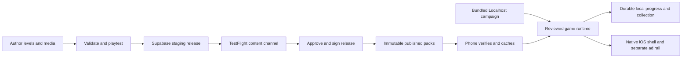

# EXCEPTION HUMAN iPhone App Store deployment plan

October 25, 2026. Proposed production direction for the United States App Store, with TestFlight as the next distribution milestone. This plan supersedes the store scope in the earlier [mobile release proposal](MOBILE_RELEASE_PLAN.md).

Ship a complete, funny, reliable first world: **20 polished Localhost levels**, the Visitor Error character, earned badges, the Sticker Desk, authored commentary, and offline play. Keep the current Capacitor game. Add a native bottom banner placement and a controlled pipeline for downloading new content. Expand toward the existing **10 worlds and 200 server slots** after players validate the first world.

The release should feel like an AI desperately trying to process a human who keeps surviving its mistakes. More levels should mean more interesting decisions, stronger jokes, and distinct departments. Level count alone is not a release gate.

## Recommended release decisions

| Area | First release | Expansion path |
| --- | --- | --- |
| Distribution | United States App Store; English; iPhone interface in landscape | Additional territories and bespoke iPad support after separate validation |
| Runtime | Existing Capacitor and bundled Canvas game | Improve the shared runtime in reviewed app updates |
| Campaign | All 20 rebuilt Localhost servers, sequential progression, satisfying finale | Nine additional 20-server worlds; deliver tested chapters in content packs |
| Advertising | Free download; one fixed bottom-center banner allocation during gameplay, menus, and level-clear receipts | Keep the same placement; content updates never configure or move advertising |
| Content backend | Supabase for publishing metadata, immutable files, and release channels | Replace the file delivery provider if measured traffic makes that worthwhile |
| Updates | Download bounded level data, authored text, artwork, audio, and season definitions | New executable behavior still ships through an app update |
| Saves | Durable device saves, preserved IDs and rewards, export and import | Optional account backup or Game Center later, through an app update |
| Economy | Existing earned Tokens and fixed cosmetic prices; no real-money purchases | Reassess paid features separately before adding purchase infrastructure |
| Audience | Teen and adult positioning; outside the Kids category | Age questionnaire and actual content determine the store rating |
| Operations | A working offline game and a reversible content publishing process | Expand cadence only when quality and support capacity permit |

An iPhone target does not automatically prevent iPad installation in compatibility mode. Test that presentation wherever Apple makes it available. Explicitly manage availability on Apple silicon Macs and Apple Vision Pro; opt out initially while those experiences remain unvalidated. [Apple device compatibility guidance](https://developer.apple.com/help/app-review/before-submitting-for-review/test-compatible-devices).

## Current starting point

The current source has twenty long Localhost campaign recipes, nine feedback labs, eight demo episodes, original comparison routes, device-local rewards, procedural audio, and separate desktop/mobile presentation. [Campaign status](DATA_CENTER_CAMPAIGN.md), [reward rules](CREDITS_AND_UNRELIABLE_HINTS.md), [native testing](CAPACITOR_LOCAL_TESTING.md).

| Observed in the checkout | Production implication |
| --- | --- |
| Capacitor 8.5.3 core and iOS dependencies are pinned | Keep this starting point; audit dependency support and licenses before choosing release versions |
| Current bundle ID is `com.threeqinnova.exceptionhuman.local`; display name is Exception Human Local | Create a production identity and consistent TestFlight identity; keep the local app available for development |
| iOS target is family 1, minimum iOS 15.0, team `NM3KNV8248` | Revalidate the OS floor against selected SDKs and actual supported hardware; verify distribution privileges |
| Package version is 0.1.0; Xcode marketing version is 1.0 and build is 1 | Establish one authoritative release version and an increasing build number |
| Xcode 27.1 and iOS SDK 27.1 are present under `/Applications/Xcode.app` | Use the explicit developer directory; global command-line selection currently points to CommandLineTools |
| Game assets are built into local HTML; no remote server is configured | Extract a content interface while keeping the bundled fallback |
| No advertising dependency or app-owned privacy manifest was found in the inspected native source | Ads, consent handling, archive privacy review, and disclosures are implementation work |
| Earlier device install and launch are documented | Reinstall and physically validate the exact release candidate; older installation evidence does not cover every later change |
| Fake billing remains disabled but its implementation exists | Preserve the source and fixtures; exclude that interaction from the production payload |

Apple currently requires the iOS 26 SDK or later for uploaded iOS apps. The installed SDK clears that minimum; an upload must still pass validation and current submission requirements. [Apple SDK requirement](https://developer.apple.com/news/?id=ueeok6yw).

## Product promise and launch experience

The player should reach the game quickly: launch, choose Play, understand move/jump/Rewrite through the first safe interactions, and meet the AI's first confidently wrong claim. Avoid an account requirement, a content download wall, and a large menu of historical experiments.

Use this primary navigation:

- **Continue** resumes the next uncleared server from its beginning; **Retry** repeats the current server.
- **Campaign** shows Localhost's four chapters and clear status. Describe the shipped campaign accurately as 20 levels.
- **Practice** offers direct campaign replay and a small set of polished challenges. Keep campaign rewards isolated from practice.
- **Collection** holds earned center badges, owned stickers, and the truthful Token Bank.
- **What's new** shows downloaded chapters and seasonal incidents after they exist.
- **Settings** contains Controls, Audio, AI Log, Downloads, Privacy, Report an ad, Support, and save export/import.

Preserve the existing local browser and developer practice catalog. For the store build, curate the release menu and compile out test dashboards, recording automation, private playtest session tools, arbitrary debug hooks, and unused comparison entry points. Features included in the release must be documented and available for review.

The detailed [level roadmap](release/app-store/LEVEL_ROADMAP.md) assigns a purpose to every launch level and a progression arc to every future world. The existing [200-server catalog](campaign/CATALOG.md) remains the naming and ID reference; 180 entries are planned layouts, not completed levels.

## Apple constraints that shape the design

Apple restricts downloaded code that changes functionality under 2.5.2. Use a reviewed runtime with bounded data and media packs, and explain the delivery system to App Review. A JSON extension alone does not make arbitrary scripted behavior acceptable. Do not assume the mini-app provisions in 4.7 exempt this game.

Rule 2.5.19 prohibits concealed or undocumented functionality. Show the content system and supported mechanics during review. Remote configuration must not become a way to reveal a different product afterward.

Rule 2.5.18 requires suitable advertising, in-app access to targeting information, and a way to report unsuitable ads. Keep the actual ad distinct from the fictional AI. [Current App Review Guidelines](https://developer.apple.com/app-store/review/guidelines/).

These rules guide the architecture; they do not guarantee approval of a particular implementation. Where a proposed content change introduces new behavior or raises the content rating, route it through app and metadata review before release.

## Bottom banner design

Use a native iOS banner through the Google Mobile Ads SDK, behind a small Capacitor interface that the game controls. AdMob is the proposed first provider; Apple does not supply the banner inventory in this design. Pin the native SDK and consent SDK versions and audit their disclosures. Start with one ad network and one placement to keep behavior understandable. [Google integration guide](https://developers.google.com/admob/ios/quick-start).

Use the bottom-center paper margin marked by the user, with movement controls at the left and Rewrite above Jump at the right. Reserve a fixed **320 × 50 point native banner** above the home indicator and within the horizontal safe areas. Keep that allocation in the same place during gameplay, menus, and clear receipts, including when no ad fills. Use a supported fixed-size SDK banner; do not let an adaptive format resize this slot. Apple does not prescribe these dimensions as a universal banner requirement. [SDK fixed banner sizes](https://developers.google.com/admob/ios/banner/fixed-size), [safe-area anchoring](https://developers.google.com/admob/ios/banner).

Placement, slot dimensions, control clearance, and presentation rules belong to the app layout and native integration. They never come from remote configuration or downloaded packs. Do not move the banner when changing levels, seasons, commentary, backgrounds, or sounds. A protected privacy/support or full-screen interruption may cover or hide the ad according to fixed client rules; its allocation is never moved or reclaimed underneath an active touch. Keep Continue, circuit actions, and other targets away from the reserved rectangle.

AdMob specifically warns about continuous gameplay interaction and ads close to controls. Maintain a separate, noninteractive boundary around the banner, no underlying game actions, and ample clearance from the actual thumb targets. Physical touch testing and the final native SDK integration must verify the resulting placement; the reserved space alone is not approval evidence. [Discouraged placements](https://support.google.com/admob/answer/6275345?hl=en), [recommended separation](https://support.google.com/admob/answer/6275335?hl=en).

Engineering and experience requirements:

1. Reserve the bottom-center slot before any screen becomes interactive. A late ad response, no fill, or content update must never move the slot or a button under a finger.
2. Compute actual webview bounds and safe areas once. Keep the game viewport, observer/glass rays, circuit hit testing, overlays, and relocated controls aligned. Preserve world geometry and physics W/H.
3. Start an inactive separation buffer of at least 24 points between the banner and touch targets during prototyping, then validate actual reach on devices. Move controls clear on smaller viewports without relocating or resizing the ad slot. This is a design target, not an Apple or AdMob approval threshold.
4. Handle no fill, consent failure, airplane mode, ad load errors, and provider outage by continuing the game. Never replace the missing ad with a misleading clickable AI notice.
5. Pause gameplay and audio appropriately when an ad opens another view or app. Return to an explicit paused state with a working audio reconnect path.
6. Do not tie ad requests to deaths, rapid retries, credits, or taps on Continue. Let the SDK/provider manage permitted refresh behavior; stop activity when hidden or inactive.
7. Put Ad privacy and Report this ad in the paused menu. Capture only the available ad response reference, placement, timestamp, app/content version, and optional user explanation. Do not collect a screenshot without the user's action.
8. Verify that the selected SDK can present the targeting explanation within the app. If it cannot meet that requirement in our configuration, change the integration before launch.
9. Use test ads for development and beta placement testing. Establish a separate, documented production candidate and a test-device procedure; do not accidentally submit a build containing sample ad units as the store product.

AdMob can be configured before the public listing, but full ad serving depends on its own readiness review and linking to a supported store listing. Prepare the developer website and root `app-ads.txt` early; allow the game to launch with little or no fill while that process completes. [AdMob app setup](https://support.google.com/admob/answer/9989980?hl=en), [app-ads.txt setup](https://support.google.com/admob/answer/9363762?hl=en).

## Privacy and audience

Target a first advertising configuration without IDFA access or cross-company tracking. Verify the entire SDK configuration, including measurement and optional identifiers; selecting nonpersonalized ads alone does not establish that tracking is absent. If tracking is introduced, obtain App Tracking Transparency authorization before it occurs and preserve full play when permission is denied. [Apple tracking guidance](https://developer.apple.com/app-store/user-privacy-and-data-use/).

Use the provider's consent platform for applicable privacy choices, including US state options. Update consent status at launch, request ads only when permitted, prevent duplicate initialization, and expose privacy options where required. Offline or unresolved consent must allow ad-free play. ATT authorization and regulatory consent are different decisions. [Google consent SDK](https://developers.google.com/admob/ios/privacy).

Prepare a data inventory covering the game, ad SDK, content host, support submissions, diagnostic tooling, and server logs. Map each data type to purpose, retention, linkage, tracking, and deletion. An ads-supported game must not claim that it collects no data simply because progression is local: the SDK may transmit network, device, interaction, and diagnostic information. Reconcile the archive's privacy manifests with App Store privacy answers. [Apple privacy details](https://developer.apple.com/app-store/app-privacy-details/), [Google SDK disclosure](https://developers.google.com/admob/ios/privacy/data-disclosure).

Position the game for teens and adults and answer Apple's age questionnaire truthfully, including cartoon loss, humor, and advertising. Choose a higher age override if the final audience policy requires it; do not choose the Kids category for this launch. A store age rating alone does not resolve child-privacy obligations. Review the actual presentation, marketing, and data practices against COPPA before public release. [Apple age ratings](https://developer.apple.com/help/app-store-connect/manage-app-information/set-an-app-age-rating/), [FTC COPPA guidance](https://www.ftc.gov/business-guidance/resources/complying-coppa-frequently-asked-questions).

Launch without player accounts, chat, user-submitted levels, location, push notifications, or runtime AI services. Commentary remains authored and approved before publishing. These choices keep the first product focused and reduce operational work.

## Content platform choice

**Use Supabase for the first content publishing service.** Its role is to manage drafts, release records, and immutable content files. The phone reads a small release manifest and downloads packs through a CDN. It does not query a database every frame or depend on the backend to simulate a level. See the [content pipeline specification](release/app-store/CONTENT_PIPELINE.md).

| Option | Where it fits | Decision |
| --- | --- | --- |
| Supabase database and Storage CDN | Linked levels, voice pools, badges, seasons, approval history, and optional future account data | Preferred first publishing backend; use a paid production environment |
| Apple-hosted Background Assets | Apple delivers separately versioned asset packs through TestFlight and the App Store | Viable Apple-only alternative; prototype native adoption and OS support before choosing it as the primary delivery path |
| Static signed packs on a CDN | A small catalog with a local publishing tool and minimal administration | Keep the client contract compatible with this simpler delivery model |
| Firebase Remote Config with separate asset storage | Parameter rollout and SDK-managed configuration caching | Possible, but it still needs asset storage and an editorial model; no reason to combine two control systems at launch |

Apple supports uploading asset packs separately from app builds and describes a review/distribution flow for them. They can satisfy the request for content changes without a new binary, though asset review and compatibility still matter. [Apple asset pack overview](https://developer.apple.com/help/app-store-connect/manage-asset-packs/overview-of-apple-hosted-asset-packs), [Apple delivery and versioning](https://developer.apple.com/videos/play/wwdc2025/325/). Firebase supplies remotely fetched parameters, not the entire content publishing workflow. [Firebase Remote Config](https://firebase.google.com/docs/remote-config).

Keep the implementation small: author in repository JSON and source assets first, validate with a publishing command, then promote a signed release. Build a dedicated editorial dashboard only when repeated publishing makes it worthwhile. Supabase Studio is for trusted operators; it is not the publishing interface for unreviewed direct edits.

## Production architecture

Keep four layers explicit: game runtime, content definitions, presentation, and platform services. Move toward shared modules incrementally; do not combine the release project with an unnecessary engine rewrite. Preserve desktop play and generated mobile/native assets through the existing builders.

The first public binary must contain every capability it advertises for downloadable packs, a working download library, and an inspectable example update. Demonstrate a new small level pack plus a commentary, badge, paper-background, and audio change in TestFlight without replacing the binary. If that exercise fails, the content pipeline is not ready.

## Delivery phases and gates

Effort ranges below assume one experienced implementation lead with regular owner playtests. Specialist art, audio, and QA can shorten elapsed time when available. Plan roughly **6 to 10 weeks to public release**, with the first internal TestFlight in **1 to 2 weeks**. These are planning estimates; account setup, external review, device defects, and player feedback can change the dates.

| Phase | Indicative effort | Concrete deliverables | Exit gate |
| --- | --- | --- | --- |
| 0 Production setup | 1 to 2 working days | Production brief, identity, release configuration, rights inventory, support destination | Correct owner/team and production identity are established; no accidental replacement of the local app |
| 1 First internal TestFlight | 3 to 5 working days after setup | Release archive of bundled Localhost, save/lifecycle smoke evidence, internal build notes | Owner installs from TestFlight and physically completes the first route, resumes audio, and retains progress after relaunch |
| 2 Content foundation | 7 to 12 working days | Shared content contract, validator, offline cache, signed publisher, staging/production separation | Same binary receives every requested content type; bad packs and outages recover safely |
| 3 Ads and privacy | 5 to 8 working days | Native banner rail, consent integration, reporting, policy/support pages, privacy inventory | Smallest-screen touch test, interruption test, denial/offline paths, and disclosure review pass |
| 4 Campaign and external beta | 7 to 12 working days plus player sessions | Polished 20-level campaign, release menus, reward migration, fresh-player sessions, wider TestFlight | No release-blocking defects; players understand the rules and want another attempt |
| 5 Store candidate and release | 3 to 5 working days plus Apple review | Final archive, screenshots, metadata, review notes, US-only availability, launch runbook | Exact candidate passes release checklist and App Review; owner selects public release |

Work on campaign copy and art can overlap technical phases. The first internal flight uses the bundled game and does not wait for the CMS or live ads. The production-feature beta must exercise both before store submission. Details and executable preparation steps are in the [TestFlight and launch checklist](release/app-store/TESTFLIGHT_CHECKLIST.md).

## Quality gates

The following are internal acceptance targets, not Apple mandates. Record the app build, content release, device, OS, route, and result with each check.

| Area | Required evidence before public release |
| --- | --- |
| Campaign | All 20 routes clear using ordinary controls; sequential progression, resource rewinds, cooling, finale, and reward banking pass current automated suites; human coverage includes every server |
| Small screens | Physical touch sessions on the smallest supported phone; Jump and Rewrite remain reachable; signs, loss copy, circuits, menus, and any banner do not collide |
| Performance | Profile a sustained 30-minute session on the weakest supported device; target 60 fps with 95% of active-play frames within 20 ms; investigate sustained frames over 33 ms, memory growth, heat, and audio glitches |
| Lifecycle | Calls, Control Center, screen lock, Bluetooth/headphone changes, ad presentation, and background/foreground preserve pause, input release, and safe audio recovery |
| Persistence | Native durable save migration, forced termination, low storage, content rollback, update installation, and duplicate reward events preserve clears, wallet, ownership, and settings |
| Content delivery | Offline first launch, timeouts, partial files, invalid signatures, incompatible packs, low disk, evicted caches, rollback, and old clients all have safe paths |
| Network | IPv6-only and impaired connectivity tests pass; no dependency on a Mac-hosted server |
| Privacy | Consent/denial/reset paths, actual SDK traffic, archive privacy report, manifest reasons, and public disclosures agree |
| Reliability | Zero unresolved critical/high defects; target at least 99.5% crash-free beta sessions once a meaningful sample exists; report sample size and investigate every reproducible failure |
| Accessibility | Reachable labeled menus and controls, sufficient contrast, readable text, motion settings, color-independent warnings, music/effects controls, and truthful accessibility declarations |
| Fun | At least 10 observed fresh-player sessions; initial target is 8 of 10 understand the controls and danger/advice distinction, and 7 of 10 clear server 1 within 10 minutes; revise encounters that fail the observed test |

These small player samples are directional production gates, not statistical proof. Capture where a player loses trust, what causes an accidental input, which joke they actually read, whether a retry feels worthwhile, and why they stop. Preserve the user's approved immediate loss burst, two-second reveal, full reading interval, and two-input skip. Do not shorten them to improve a metric without a new design decision.

Prefer Xcode diagnostics and TestFlight feedback at first. If product analytics is needed, add a small documented event set: session, level start/clear/failure family, content failure, reward award, and consent/ad availability. Avoid raw input recording, full play recordings, advertising IDs, and player text by default. Label pseudonymous data honestly and keep retention bounded.

## US store submission

Select only **United States** in App Store availability and keep new territories from being added automatically. This chooses storefront access based on the customer's Apple Account country or region; it is not a physical-location geofence. Invite the initial US TestFlight cohort by email rather than assuming that store availability restricts beta invitations. [Apple territory settings](https://developer.apple.com/help/app-store-connect/manage-your-apps-availability/manage-availability-for-your-app-on-the-app-store).

Prepare the final title, subtitle, actual device screenshots, description, keywords, support URL, privacy URL, age answers, content rights, accessibility answers, review contact, and encryption declaration. Describe the shipped 20 levels and optional downloads accurately. Explain that the antagonist is fictional, the snark is authored, and Tokens are earned cosmetics. Include reviewer instructions for the content library, ad privacy/reporting, cooling console, and offline mode.

Assess export compliance for the final binary, including HTTPS and content signature verification; do not copy an encryption answer from an earlier offline build. [Apple export compliance](https://developer.apple.com/help/app-store-connect/manage-app-information/overview-of-export-compliance/).

Use manual release for 1.0. Apple's phased-release facility applies to version updates; control the initial launch's exposure through the US-only storefront and marketing pace. Keep content fixed during final review unless a documented repair is necessary. [Apple phased updates](https://developer.apple.com/help/app-store-connect/update-your-app/release-a-version-update-in-phases/). Store captures and archives under ignored `outputs/app-store/`; source artwork stays in source asset directories according to [artifact policy](ARTIFACT_POLICY.md).

## Budget and operating capacity

Supabase Pro currently starts at **$25 per month**, with the first project included and additional projects starting at **$10 per month**. Its published quotas distinguish cached and uncached egress, and free projects can pause after inactivity. Budget for production and a separate staging project rather than relying on a sleeping free service. [Current Supabase pricing](https://supabase.com/pricing).

Set an initial operating allowance of **$50 to $150 per month** for hosting, support/domain costs, and modest monitoring, plus implementation costs and Apple's standard **$99 annual membership** if a renewal or enrollment is needed. Confirm the existing team's membership rather than enrolling again. This is a project budget, not a vendor quote. Recalculate before provisioning. Avoid paid analytics and extra infrastructure until measurements justify them. [Apple membership terms](https://developer.apple.com/programs/enroll/).

Model download traffic explicitly. For example, **10,000 installations × 20 MB of additional media = about 200 GB** before retries and overhead. Bundle Localhost, deduplicate shared media, and download optional packs once. Monitor CDN hit rate and egress. If media traffic becomes expensive, move immutable files to a provider such as Cloudflare R2 while retaining the same signed manifest contract; R2 currently charges storage/operations and does not charge direct egress. [R2 pricing](https://developers.cloudflare.com/r2/pricing/).

Banner income is uncertain. Forecast it as filled impressions divided by 1,000, multiplied by observed net eCPM; use measured viewability and fill. Set a monthly cost ceiling that does not depend on a revenue promise. Do not pay for expansion through increasingly intrusive interruptions.

## Main production risks

| Risk | Response | Evidence that resolves it |
| --- | --- | --- |
| Bottom ads crowd controls or invite accidental taps | Keep the marked bottom-center allocation fixed; group actions at the right and maintain an inactive buffer | Physical touch observations on the smallest supported screen and an SDK/policy review |
| A downloadable pack exceeds the reviewed runtime's scope | Enforce a closed mechanic registry; send new behavior through an app update | Validator rejection cases and a documented review demonstration |
| The production app appears to lose the owner's local progress | Keep development and production identities explicit; provide validated export/import | Same real save transferred, reopened, and rewarded only once |
| A bad release or backend outage blocks play | Bundle Localhost, activate atomically, retain prior content, rehearse rollback | Impaired-network, force-termination, and recovery exercises |
| Twenty long routes feel repetitive or exhausting on phones | Review decisions and chapter rhythm with fresh players | Observed retries, stopping points, readability, and optional-route enjoyment |
| The ad SDK's behavior differs from the intended privacy configuration | Inspect real traffic and archive disclosures before monetization | Consent/denial tests and a complete SDK/data inventory |
| Live fill or download costs disappoint | Treat ad revenue as measured income and cap operating spend | Actual fill, impressions, bandwidth, and support cost after launch |
| Expansion exceeds authoring capacity | Deliver five-level chapters after a measured pilot | Time and defect counts from producing and supporting the first chapter |

## Live operation after launch

For the first 72 hours, review crashes, save failures, content errors, ad complaints, and support at least daily. Keep one person responsible for stopping a bad content rollout or stopping ad serving through the provider's operational controls. Content configuration contains no ad placement, size, format, or screen-selection fields; the bottom-center allocation stays fixed even when serving stops.

Use this initial cadence:

- First two weeks: repair reliability, readability, and onboarding before expanding the campaign.
- First content pilot: a small permanent incident pack using reviewed mechanics, after the launch cohort establishes a baseline.
- World expansion: one five-server chapter at a time when authoring, device tests, and human playtests pass. Four chapters complete a center and its earned badge.
- Seasonal content: a small themed incident set, paper treatment, authored jokes, audio variation, and one earned commemorative badge. Keep earned items and an archive path after the featured window.
- Binary maintenance: planned releases for engine changes, SDK updates, security repairs, new purchase/account features, and new mechanic families, regardless of content cadence.

Own the following responsibilities even if one person fills several roles: game direction and pacing; runtime/content engineering; art/audio and rights; QA/device coverage; privacy/store administration; publishing/support. The owner makes the fun and public-release decisions. The implementation lead maintains reproducible builds and rollback evidence.

## Immediate next work

Begin phase 0 and the first TestFlight checklist: establish the production identity, preserve the owner's local save, create a clean release configuration, and archive the bundled campaign. Deliver the archive and its evidence before performing an upload. The request in this planning pass does not create cloud resources, change Apple accounts, upload a build, or publish the game.

The next milestone is concrete: **EXCEPTION HUMAN installed from internal TestFlight on the owner's iPhone, with the current campaign playable offline and a recorded physical smoke test**. The following milestone adds the native banner and a demonstrated content update on the same binary.
